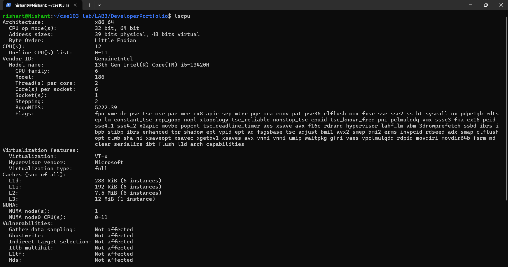
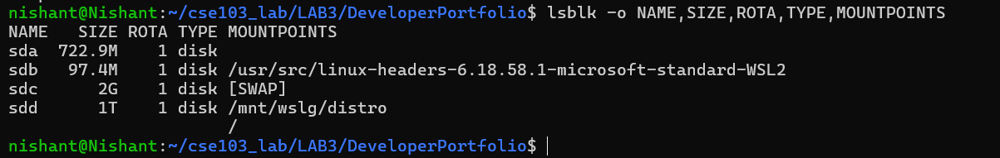
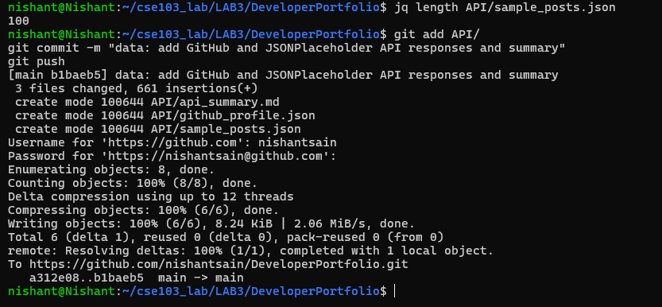
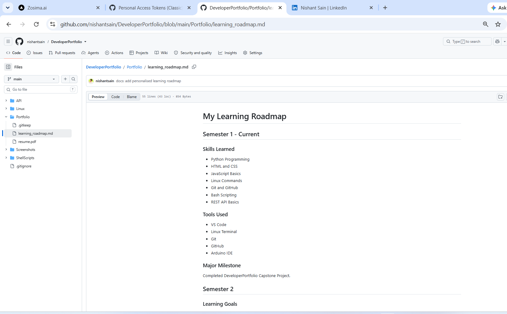
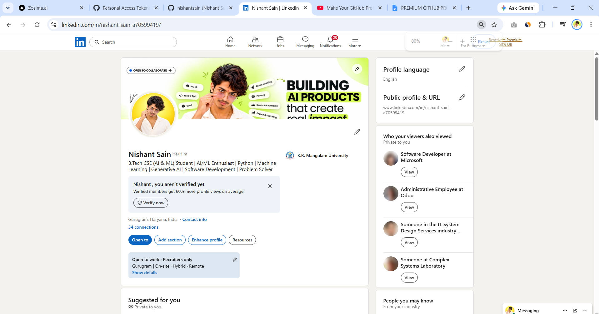

# DeveloperPortfolio

A student developer portfolio and capstone repository documenting Linux system administration basics, Bash shell scripting, REST API interaction, career planning, and a personal portfolio website.

## About DeveloperPortfolio

DeveloperPortfolio is a structured repository created as part of the B.Tech CSE (AI/ML) capstone work. It brings together technical documentation, automation scripts, API exercises, career materials, and portfolio website source code.

## Project Objectives

- Practice Linux terminal commands and system inspection.
- Document system information and command outputs.
- Create and test Bash shell scripts.
- Retrieve and inspect data from REST APIs using command-line tools.
- Prepare a technical resume and semester-wise learning roadmap.
- Maintain professional GitHub and LinkedIn profiles.
- Publish a personal portfolio website using GitHub Pages.

## Repository Structure

```text
DeveloperPortfolio/
├── API/
├── Linux/
├── Portfolio/
│   ├── resume.pdf
│   └── learning_roadmap.md
├── Screenshots/
├── ShellScripts/
├── index.html
└── README.md
```

## Linux Documentation

Linux command exercises include CPU, memory, storage, and system information inspection. Supporting notes and command outputs are maintained in the `Linux/` directory.

### Linux system information


### Memory information


### Storage information


## Shell Scripts

The `ShellScripts/` directory contains Bash automation scripts, including system information reporting and backup functionality.

### System information script output


### Backup script source


> Note: The supplied screenshot archive did not contain clear evidence of a successful backup archive creation. Add a `backup_demo.png` image here only after running the script successfully and capturing the resulting archive and log output.

## API Integration

The `API/` directory contains API-related command-line exercises and retrieved JSON data. The work includes GitHub API inspection and a JSONPlaceholder request.

### GitHub API output


### JSONPlaceholder API output


## Technical Resume

The technical resume is available in `Portfolio/resume.pdf`.

### Resume preview


## Learning Roadmap

The semester-wise learning plan is documented in `Portfolio/learning_roadmap.md`.

### Learning roadmap preview


## Screenshots

The `Screenshots/` directory contains selected evidence for the main project activities, including Linux commands, shell scripts, API work, resume, roadmap, professional profiles, and portfolio source.

## GitHub Profile

GitHub profile: [github.com/nishantsain](https://github.com/nishantsain/)


## LinkedIn Profile

LinkedIn profile: [Nishant Sain](https://www.linkedin.com/in/nishant-sain-a70599419/)



## Portfolio Website

The portfolio website source is maintained in the root `index.html` file.

### Website source


GitHub Pages URL: https://nishantsain.github.io/DeveloperPortfolio/

> Verify that GitHub Pages is enabled and the live URL loads successfully before treating deployment as complete. The supplied screenshot archive did not include a clear live website browser screenshot.

## Contact

- **Name:** Nishant
- **Programme:** B.Tech CSE (AI/ML)
- **University:** K.R. Mangalam University
- **Email:** nishantsain701@gmail.com
- **GitHub:** [nishantsain](https://github.com/nishantsain/)
- **LinkedIn:** [Nishant Sain](https://www.linkedin.com/in/nishant-sain-a70599419/)
