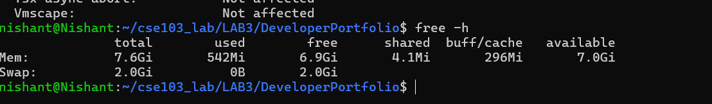
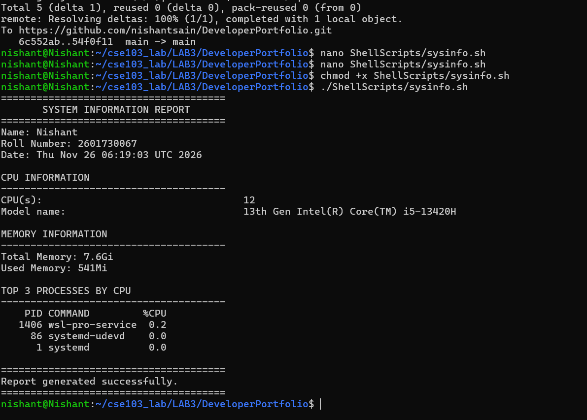
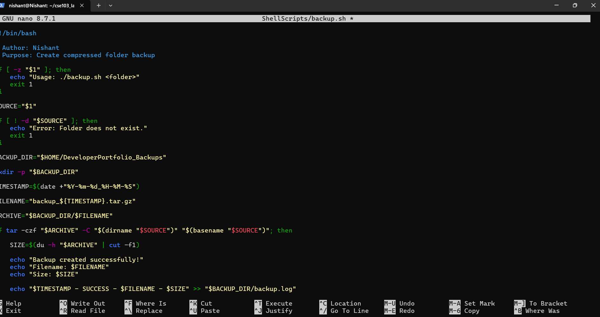
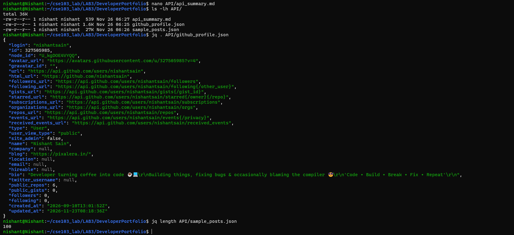
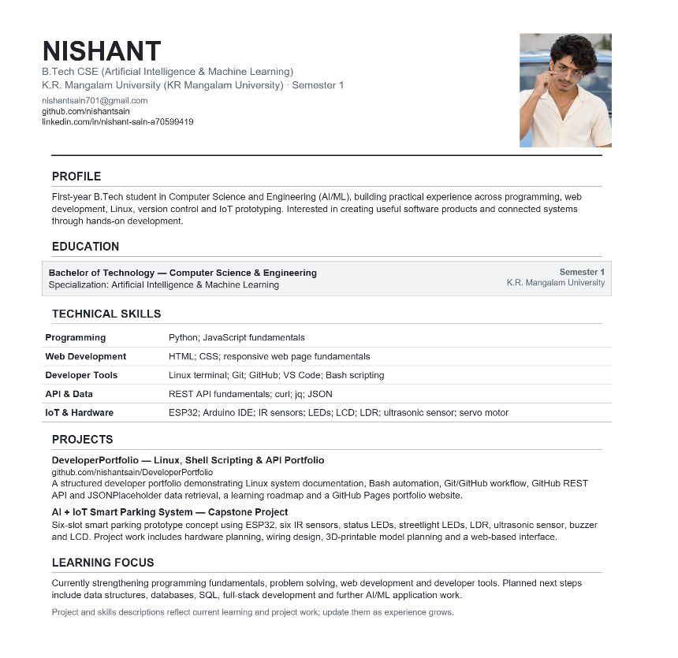
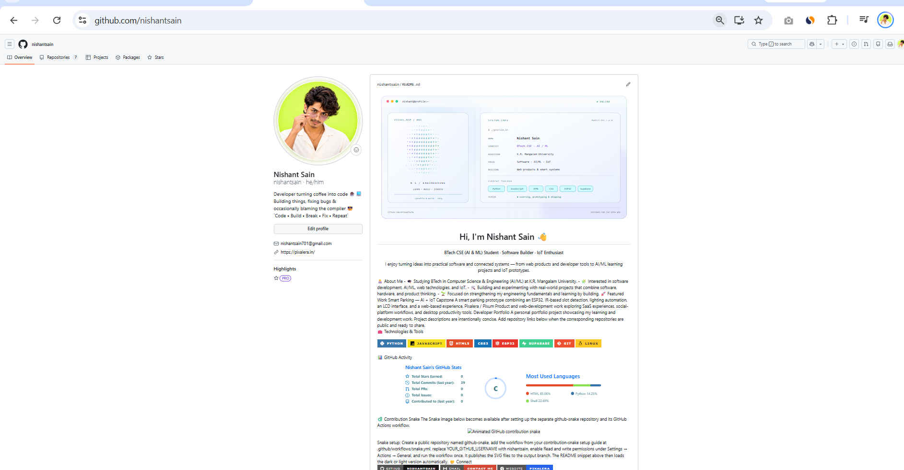
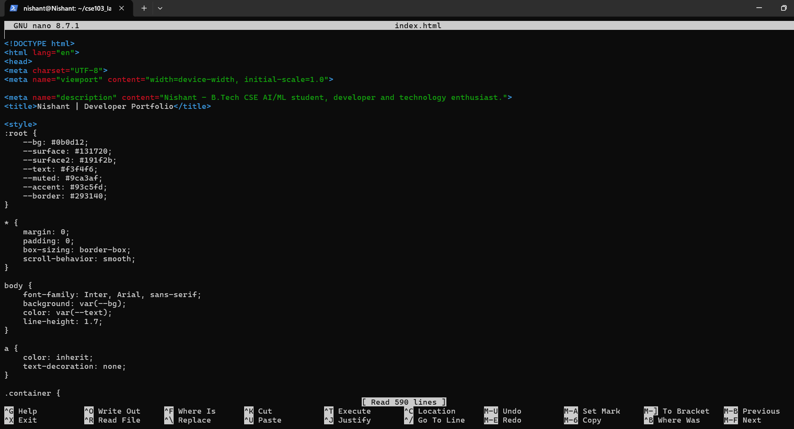

<div align="center">

# DeveloperPortfolio

**A student developer portfolio and capstone repository**

Linux System Documentation · Bash Automation · REST API Interaction · Career Roadmap · Personal Website

<p>
  <a href="https://github.com/nishantsain/DeveloperPortfolio">
    
  </a>
  <a href="https://github.com/nishantsain/">
    
  </a>
  <a href="https://www.linkedin.com/in/nishant-sain-a70599419/">
    
  </a>
</p>

**B.Tech CSE (AI/ML) · K.R. Mangalam University**

[About](#about-developerportfolio) ·
[Objectives](#project-objectives) ·
[Structure](#repository-structure) ·
[Documentation](#linux-documentation) ·
[Scripts](#shell-scripts) ·
[APIs](#api-integration) ·
[Portfolio](#career-portfolio) ·
[Contact](#contact)

</div>

---

## About DeveloperPortfolio

DeveloperPortfolio is a structured repository created as part of the B.Tech CSE (AI/ML) capstone work. It brings together technical documentation, automation scripts, API exercises, career materials, and portfolio website source code.

The project demonstrates practical developer workflows, from using Linux commands and Bash scripts to retrieving API data, organizing files with Git, and publishing a personal portfolio website.

## Project Objectives

| Area | Objective |
|---|---|
| Linux fundamentals | Inspect CPU, memory, storage, kernel, and operating-system information. |
| Shell scripting | Create and execute Bash scripts for system reporting and folder backup. |
| API interaction | Retrieve and inspect REST API responses using `curl` and `jq`. |
| Version control | Organize project files and maintain a meaningful Git commit history. |
| Career preparation | Prepare a technical resume and a semester-wise learning roadmap. |
| Personal branding | Maintain GitHub and LinkedIn profiles and publish a portfolio website. |

## Technology Stack

<div align="center">

| Languages & Web | Tools | Concepts |
|---|---|---|
| Python · HTML · CSS · JavaScript | Linux · Bash · VS Code | REST APIs · JSON |
| | Git · GitHub · GitHub Pages | Version Control |

</div>

## Repository Structure

```text
DeveloperPortfolio/
├── API/
│   ├── github_profile.json
│   ├── sample_posts.json
│   └── api_summary.md
├── Linux/
│   ├── system_profile.md
│   └── commands_output.txt
├── Portfolio/
│   ├── resume.pdf
│   └── learning_roadmap.md
├── Screenshots/
├── ShellScripts/
│   ├── sysinfo.sh
│   └── backup.sh
├── index.html
└── README.md
```

## Linux Documentation

Linux command exercises include CPU, memory, storage, and system information inspection. Supporting notes and command outputs are maintained in the `Linux/` directory.

| Command | Purpose |
|---|---|
| `lscpu` | Displays CPU model and processor information. |
| `free -h` | Displays memory usage in a readable format. |
| `lsblk` | Lists block devices and storage layout. |
| `uname -a` | Displays kernel and system information. |

<details>
<summary><strong>View Linux screenshots</strong></summary>

### Linux system information


### Memory information


### Storage information


</details>

## Shell Scripts

The `ShellScripts/` directory contains Bash automation scripts for system reporting and folder backup.

| Script | Description |
|---|---|
| `sysinfo.sh` | Generates a report containing CPU, memory, and top process information. |
| `backup.sh` | Creates a compressed archive of a supplied source directory and records the result in a log. |

### System information script output


### Backup script source


> The supplied screenshot shows the backup script source. Add a separate successful-run image after capturing the generated archive filename, size, and backup log entry.

## API Integration

The `API/` directory contains API-related command-line exercises and retrieved JSON data. The work includes GitHub profile inspection and a JSONPlaceholder request.

### GitHub API output


### JSONPlaceholder API output


## Career Portfolio

### Technical Resume

The technical resume is available at [`Portfolio/resume.pdf`](Portfolio/resume.pdf).



### Learning Roadmap

The semester-wise learning plan is documented in [`Portfolio/learning_roadmap.md`](Portfolio/learning_roadmap.md).


## Screenshots

The `Screenshots/` directory contains selected evidence for Linux commands, shell scripts, API work, career documents, professional profiles, and the portfolio website.

<details>
<summary><strong>GitHub profile screenshot</strong></summary>



</details>

<details>
<summary><strong>LinkedIn profile screenshot</strong></summary>


</details>

<details>
<summary><strong>Portfolio website source screenshot</strong></summary>



</details>

## Portfolio Website

The portfolio website source is maintained in the root [`index.html`](index.html) file.

**GitHub Pages:** [https://nishantsain.github.io/DeveloperPortfolio/](https://nishantsain.github.io/DeveloperPortfolio/)

> Confirm that GitHub Pages is enabled and the live URL loads correctly before presenting deployment as complete. Add a browser screenshot of the live website to the `Screenshots/` folder after verification.

## Contact

- **Name:** Nishant
- **Programme:** B.Tech CSE (AI/ML)
- **University:** K.R. Mangalam University
- **Email:** [nishantsain701@gmail.com](mailto:nishantsain701@gmail.com)
- **GitHub:** [github.com/nishantsain](https://github.com/nishantsain/)
- **LinkedIn:** [Nishant Sain](https://www.linkedin.com/in/nishant-sain-a70599419/)

---

<div align="center">
  <sub>Created by Nishant · DeveloperPortfolio Capstone Project</sub>
</div>
